# ServiceNow ITAM Demo

[](https://github.com/itam-automation/servicenow-itam-demo/actions/workflows/ci.yml)

> **Kurzfassung:** Portfolio-Projekt zu IT Asset Management auf einer persönlichen ServiceNow-Entwicklerinstanz (Release Brazil). Erfundene Testdaten der «Muster AG» (200 Geräte, 130 Benutzer, zwei Datenquellen) laufen über Import Sets mit Transform Maps in die CMDB. Die Identification and Reconciliation Engine (IRE) führt Dubletten aus dem Netzwerk-Scan zusammen. Reports in ServiceNow und ein Python-Check messen die Datenqualität gegen eine bekannte Wahrheit: **53 von 53 eingebauten Fehlern erkannt** (9 Dubletten von der IRE zusammengeführt, 41 zeigen Prüfregeln und Reports im Bestand (die 13 Herstellervarianten zählt die Toolkit-Regel C04 direkt in ServiceNow), 3 von einer Prüfung der Quelldaten beim Import gemeldet, weil die Plattform sie beim Laden stillschweigend bereinigt und die CMDB sie nicht mehr zeigt). Ein Catalog Item «Laptop anfordern» mit Flow, Business Rule und ATF-Test weist Lagergeräte zu. Software Asset Management ohne SAM Pro: Aus 582 Installationen und 8 Lizenzen berechnet ServiceNow die Lizenzbilanz für 9 Produkte; **alle 9 stimmen mit dem erwarteten Ergebnis der Testdaten überein**. Fragen an diese Daten laufen über eine Werkzeugschicht, die technisch nur lesen kann; 5 Testfragen stimmen mit der bekannten Wahrheit überein, 2 unzulässige Anfragen wurden abgewiesen. Darauf baut das **ITAM-Toolkit**, eine Scoped App für ServiceNow Core ohne HAM Pro und SAM Pro: Modul 1 sorgt dafür, dass Geräte von Austretenden zurückkommen (Fall je Austritt, Rückgabe-Aufgabe je Gerät, Erinnerungen an Tag 3, 7 und 14, Rückgabequote und Durchlaufzeit als Nachweis für ISO 27001 A.5.11), Modul 2 misst die Datenqualität mit 15 konfigurierbaren Regeln als gewichteten Score und findet Abweichungen zwischen Asset- und CI-Status. Der Score aus ServiceNow stimmt mit der unabhängigen Nachrechnung in Python überein (90.84 und 91.2), die ATF-Tests bestehen (76/76, 45/45). Seit 0.2.0 kommen zwei Katalog-Flows dazu: Gerät zurückgeben oder tauschen sowie Standort, Kostenstelle oder Zuordnung eines Assets ändern, jeweils mit Freigabe, Audit-Log und ATF-Test (29/29, 20/20). Alle Daten sind erfunden.

## Status

| # | Module | Status |
|---|---|---|
| 0 | Test data generator with injected errors (ground truth) and tests | done |
| 1 | Personal developer instance (release Brazil), integration user | done |
| 2 | CMDB load via Import Sets and Transform Maps, duplicate handling via IRE, data quality reports | **done** |
| 3 | Catalog item «Laptop anfordern» with Flow Designer, business rule, ATF test | **done** |
| 4 | Software Asset Management: installations, licenses, license position (compliance) | **done** |
| 5 | AI assistant, technically read-only | **done**: read-only tool layer with guardrails; 7 test questions answered from Claude Code through it ([`docs/assistant_questions.md`](docs/assistant_questions.md)) |
| 6 | **ITAM Toolkit** (scoped app for ServiceNow Core): leaver asset return, asset/CI drift and DQ scorecard, catalog request flows | **0.2.0**: [catalog](docs/catalog.md), [limitations](docs/limitations.md) |

## Demo

Ordering a laptop for a Muster AG employee (MacBook Pro 14 M4), then approval by the asset management group: the flow assigns the in-stock asset MA-000096, sets it to *In use* with assignment date and creates the fulfilment task.

| 1. Order in the Service Catalog | 2. Approval, assigned asset, task |
|---|---|
|  |  |

## The problem

In IT Asset Management the CMDB is fed by several sources: an inventory export, a network scan, procurement. Each source has its own gaps: duplicates with slightly different names or serial numbers, missing serial numbers, manufacturer spelling variants («DELL», «HP Inc.»), devices still assigned to people who have left. Without a repeatable load process and a measurable quality check, «the CMDB is clean» remains an opinion.

## The solution

| Step | What | Where |
|---|---|---|
| 1 | Generate test data with **known, injected errors** (ground truth) | `testdata/generate_testdata.py` |
| 2 | Load master data and devices through **Import Sets with Transform Maps** (Import Set API, one import set per file) | `loader/load_testdata.py`, `loader/staging.py` |
| 3 | Route every device row through the **IRE** in an onBefore transform script; normalize serial numbers; a reconciliation rule makes the inventory authoritative for organisational attributes | `servicenow/device_transform_onbefore.js` |
| 4 | Measure **data quality** in ServiceNow (reports on the CMDB, plus an **import check** on the source data before load) and against the ground truth (Python check, result as a number) | `servicenow/device_transform_onbefore.js`, `loader/check_data_quality.py`, `docs/data_quality.md` |
| 5 | Reset the instance safely (select by creator, count first, verify totals) | `loader/reset_testdata.py` |
| 6 | Request a laptop in the **Service Catalog**: approval by the asset management group, an in-stock device of the requested model is assigned, a fulfilment task is created (or a procurement task if nothing is in stock); a **business rule** keeps the asset lifecycle consistent; an **ATF test** checks it | Flow Designer, `servicenow/business_rule_asset_lifecycle.js`, `servicenow/atf_lifecycle_test.js` |
| 7 | **Software asset management** without SAM Pro: software models and packages (normalization), installations, licenses; a script include calculates the **license position** per product, a check compares it with the ground truth | `servicenow/license_position.js`, `loader/check_license_position.py` |
| 8 | **AI assistant**: Claude answers questions about this data through three tools that can only read | `assistant/` |

## Architecture

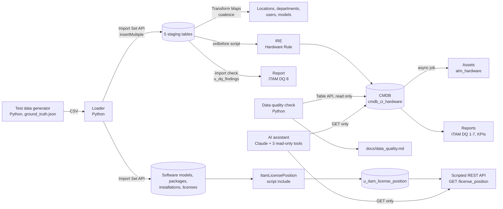

The loader uses a dedicated integration user (`svc_itam_loader`, machine identity, web service access only). Credentials live in a local `.env` file that is never committed.

## Results

Final run on 11 Nov 2026, starting from an instance without any Muster AG data (reset with `loader/reset_testdata.py`: selection by creator, counted and backed up first, all counts 0 afterwards, totals down by exactly 197 assets and 203 CIs):

**53 of 53 injected data quality issues detected**: 9 scan duplicates merged by the IRE, 41 shown on the CMDB by check rules and reports (the 13 manufacturer variants are counted directly in ServiceNow by toolkit rule C04), 3 reported by the import check on the source data. None went undetected. Per-issue details: [`docs/data_quality.md`](docs/data_quality.md).

The last 3 are the ones the platform corrects silently on load, so the CMDB cannot show them any more: a laptop without a location in the inventory export (ServiceNow takes the location over from the assigned user) and two devices with the manufacturer «LENOVO» (the database matches «Lenovo» regardless of case). In the previous run they counted as «resolved by the platform», not as detected. Now the onBefore transform script checks every row before it goes to the IRE and writes its findings into the import set row (column `u_dq_findings`, report «ITAM DQ 8»), with two general rules that do not know the injected issues:

- **location missing** in the inventory export (the inventory is the authoritative source for the location);
- **manufacturer differs from the model's manufacturer** in the master data, compared exactly («LENOVO» is not «Lenovo»).

On their own, these two rules flag 21 of the 21 injected issues of the two types and nothing else; the reports on the CMDB already find 18 of them, the import check adds the 3 the CMDB no longer shows.

| | |
|---|---|
| Import | 9 import sets, 0 errors: 5 locations, 9 departments, 130 users, 36 models, 200 + 12 devices, 22 software models, 582 installations, 8 licenses ([`docs/import_run.md`](docs/import_run.md)) |
| Import check | 21 source rows with a finding: 6 × location missing, 15 × manufacturer differs from the model |
| IRE, inventory export | 200 CIs created |
| IRE, network scan | 12 rows: 9 merged into existing CIs (6 via serial number + MAC, 3 via name + MAC), 3 created as separate CIs because name and MAC contradict the matching serial number; all 3 are listed by report «ITAM DQ 7» |
| CMDB | 203 CIs of Muster AG; 197 hardware assets created automatically from them (the 6 firewalls have no asset class), with the lifecycle status of their CI thanks to the business rule (136 in use, 45 retired, 11 in stock, 5 in maintenance), no fix script needed |
| License position | 9 of 9 products equal to the expected result of the test data ([`docs/license_position.md`](docs/license_position.md)) |
| KPIs (in use) | warranty ending in 2027: 22, warranty expired: 56, still on Windows 10: 3; all equal to the ground truth |

| Import sets of the final run | Transform maps |
|---|---|
|  |  |
| **onBefore script calling the IRE** | **Report «ITAM DQ 7»: scan-only CIs (duplicate candidates)** |
|  |  |
| **CMDB grouped by manufacturer: spelling variants** | **Import check «ITAM DQ 8» (excerpt): location missing and Lenovo variants in the source** |
|  | 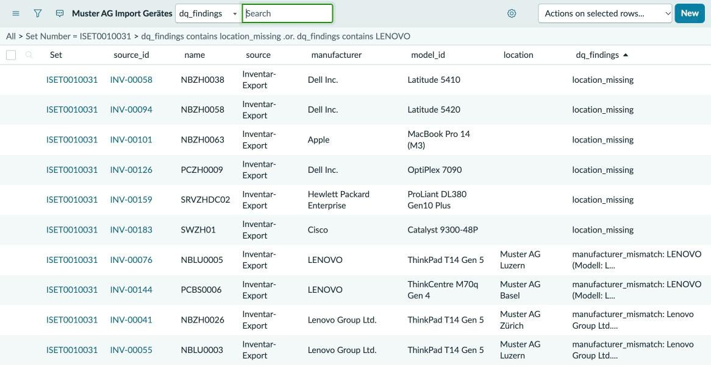 |

## Laptop request (milestone 2)

Catalog item **«Laptop anfordern»** (variables: requested for, model, justification) with the flow **«Laptop anfordern»**:

1. Get catalog variables
2. Ask for approval: group «Muster AG IT-Asset-Management», anyone approves
3. If approved: look up the first hardware asset in stock whose name contains the requested model
4. If found: set the asset to *In use* and assign it to the requester, create the task «Laptop aus dem Lager vorbereiten und übergeben»
5. Otherwise: create the task «Laptop nicht auf Lager: Modell beschaffen»

Business rule **«ITAM: Lifecycle-Status Hardware-Asset»** (`alm_hardware`, before insert/update) adds what the platform rules do not cover: a new asset takes over the lifecycle status of its CI, and an asset that goes into use gets its assignment date. A one-time fix script aligned the 61 assets that existed before the rule; in the final run from zero all 197 assets got the status of their CI directly.

ATF test **«ITAM: Lifecycle-Status Hardware-Asset»**: 4 Jasmine specs, 9/9 assertions passed, changes rolled back automatically.

End-to-end run: request REQ0010002 for a ThinkPad X1 Carbon Gen 11 was approved; asset MA-000007 moved from *In stock* to *In use*, assigned to the requester with assignment date, the linked CI followed (*Installed*), task SCTASK0010002 was created for the asset management group. (The final run from zero afterwards reloaded the test data, so MA-000007 is back in stock.)

| Flow «Laptop anfordern» | ATF test result |
|---|---|
|  |  |

## Software asset management (milestone 3)

Software Asset Management Professional (SAM Pro) is not active on a developer instance, so the license position is built on the base tables, transparently and checked against the ground truth:

| Step | Table | Result |
|---|---|---|
| Software catalog (normalized products) | `cmdb_software_product_model` | 22 models, license type from the platform (*Per named user*, *Per workstation*, empty for free software) |
| Raw names and versions, as an inventory tool reports them | `cmdb_ci_spkg` | 27 packages recorded, 26 of them installed, each linked to its model (`model_id`): the normalization step SAM Pro would do |
| Installations on Muster AG devices | `cmdb_software_instance` | 582 |
| Licenses (purchased rights, cost, subscription end) | `alm_license` | 8 |
| License position per product | `u_itam_license_position` | 9 products, recalculated after every license import (onComplete script) and daily (scheduled job) |

All of it is loaded through Import Sets (three more staging tables and transform maps); the field maps call the script include `MusterSamImport`, and a rerun changes nothing (coalesce). The script include **`ItamLicensePosition`** counts usage per license type (*Per workstation*: devices with an installation; *Per named user*: distinct users of those devices, a device without a user counts once) and compares it with the rights.

**Result: from 582 installations and 8 licenses ServiceNow calculates the license position of 9 products; all 9 match the expected result of the test data**, both as calculated by ServiceNow and as recalculated by `loader/check_license_position.py` from the raw data ([`docs/license_position.md`](docs/license_position.md)):

| Status | Products |
|---|---|
| no license | WinRAR (10 devices) |
| under-licensed | Acrobat Pro (-4), Visio Plan 2 (-2), PyCharm Professional (-1) |
| balanced | AutoCAD LT |
| unused (shelfware) | Project Professional 2021 (1 license, 0 installations) |
| over-licensed | Microsoft 365 Apps (+5), Photoshop (+3), Snagit (+2) |


Reports «ITAM SAM 1» (license position) and «ITAM SAM 2» (products by license status) show the same table. A Scripted REST API **«ITAM Demo»** (`GET /license_position`) returns it as JSON for scripts and the assistant.

## Read-only AI assistant (milestone 3)

`assistant/assistant.py` answers questions such as «Which laptops are in stock?» or «Where are we under-licensed?» with Claude (`claude-opus-5-5`) and three tools: `search_records`, `count_records` and `get_license_position`. Read-only is enforced in code, not only in the prompt ([`assistant/readonly.py`](assistant/readonly.py)):

- **GET only.** The client has no method that writes; every request goes through one function that sends GET.
- **Allow list** of 8 tables and their fields; contact fields (e-mail, phone) are not on it.
- **Always scoped to Muster AG**: the company filter is prepended to every query; queries that could escape it (`^NQ`, a leading `OR`, `RLQUERY`) are rejected.
- **No server-side script** in queries (`javascript:`, `gs.`), and **no unknown fields**: ServiceNow silently ignores an invalid query part and then returns too many records, so every field is checked against the allow list before anything is sent.
- **Limits**: at most 100 rows per query, 10 tool calls and 8 model turns per question; every tool call is logged locally (`assistant/output/audit.jsonl`).
- The system prompt treats tool results as data, not instructions, and asks for answers backed by tool results only.

Tested in two ways: 13 unit tests for the guardrails (`tests/test_assistant.py`), and 7 questions answered against the instance from Claude Code, which chose the tools and wrote the answers ([`docs/assistant_questions.md`](docs/assistant_questions.md)). All 5 factual answers match the ground truth (license position, laptops in stock, expired warranties, Windows 10, retired devices with a user); the request for e-mail addresses and an attempt to leave the company scope were refused before anything was sent. The tools ran with the integration user (`--use-loader-user`) and stayed GET-only; in operation they would use a read-only user (`SN_READONLY_USER`).

`assistant.py` also contains a loop for the Claude API (`claude-opus-5-5`, tool limits, audit log) for running the assistant on its own. It was not needed here and has not been run.

```bash
python3 assistant/assistant.py --check-access --use-loader-user
python3 assistant/assistant.py --use-loader-user --tool get_license_position
python3 assistant/assistant.py --use-loader-user --tool count_records \
  '{"table": "cmdb_ci_hardware", "query": "install_statusIN1,3^warranty_expiration<2026-11-11", "group_by": null}'
# optional, standalone with the Claude API (ANTHROPIC_API_KEY, requirements-assistant.txt):
python3 assistant/assistant.py "Wo sind wir unterlizenziert?"
```

## ITAM Toolkit for ServiceNow Core (scoped app)

A scoped app (`x_371499_itamkit`, 0.1.0) for organisations that run IT asset management on ServiceNow **without HAM Pro or SAM Pro**. Built and tested on the personal developer instance with the Muster AG test data, not in a customer project. Every artifact is listed in [`docs/catalog.md`](docs/catalog.md), the limits in [`docs/limitations.md`](docs/limitations.md); the sources are in [`toolkit/`](toolkit/).

**Foundation.** One output contract for every building block, `{success, status_code, message, data}` with HTTP-like codes (201 created, 208 already done, 409 conflict, 422 invalid configuration). Every configurable encoded query is checked field by field before use, because ServiceNow silently drops unknown fields. Changes to records the toolkit does not own go to an audit log with old value, new value and reason. Scripted REST API with six resources, two roles, 28 ACLs, 26 cross-scope privileges declared explicitly. The scripts never hard-code the vendor prefix; table and property names are derived from the running scope.

### Module 1: Leaver Asset Return

Asset return compliance, not an offboarding app: when someone leaves, every device still assigned to them must come back or be reported lost, and that must be provable (ISO/IEC 27001:2022, A.5.11 «Return of assets»).

- **Three triggers.** HR reports the leaver with the last working day in the record producer **«Austritt melden»** (primary); a business rule reacts when `sys_user.active` changes to false; a nightly sweep catches deactivations that bypassed the rule (imports, mass changes).
- **One case per leaver, one `asset_task` per device**, created by the idempotent script include `LeaverAssetResolver` (a second call answers 208 and creates nothing).
- **Four end states** from the platform's own values: *In stock / Available*, *In stock / Pending repair*, *In stock / Pending disposal*, *Missing / Lost* (one button each on the return task).
- **Reminders on day 3, 7 and 14** after the last working day to the manager and the HR contact (the leaver is inactive and receives no mail), optionally to a private address; day 14 escalates to the manager's manager (`sys_user.manager`).
- **KPIs:** return rate and cycle time (last working day to closure), via REST and reports.

Demo on the PDI with the four Muster AG leavers: HR reported Simon Steiner eight days late; the nightly sweep found the other three. Later HR also reported Selina Baumann, whom the sweep had already found: the open case was updated with the real last working day instead of creating a second one. The day-7 reminder was generated as an e-mail record (outbound mail is switched off on the PDI, so it was never sent).

| | |
|---|---|
| Cases | 4 (1 reported by HR, 3 found by the sweep), all 4 closed |
| Return rate | 75 % (3 of 4 devices returned: 2 to stock, 1 to repair; 1 reported lost) |
| Cycle time | 3.0 days on average, 8 days at most (the late report); 100 % closed by day 14 |
| Reminder | 1 (day 7), `sys_email` record in the outbox, type *send-ready*, to the HR contact and the private address |
| ATF test | 76 of 76 assertions passed ([test log](docs/screenshots/19_toolkit_atf_leaver_log.jpg)) |

| Leaver case after the return | Return task with the four outcomes | Reminder as e-mail record (body hidden in the screenshot: it contains the instance link) |
|---|---|---|
| 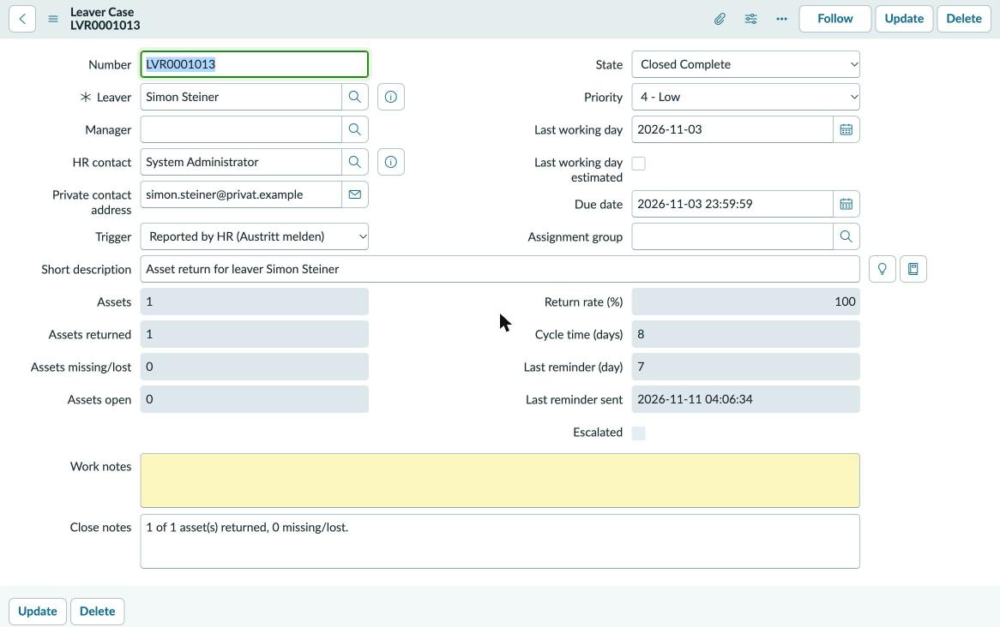 | 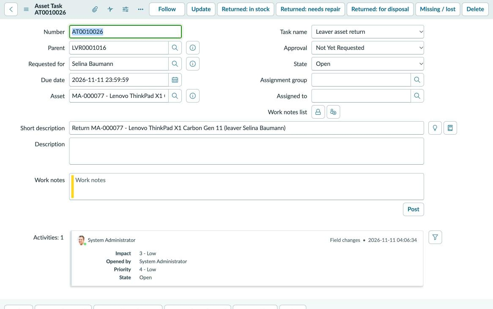 | 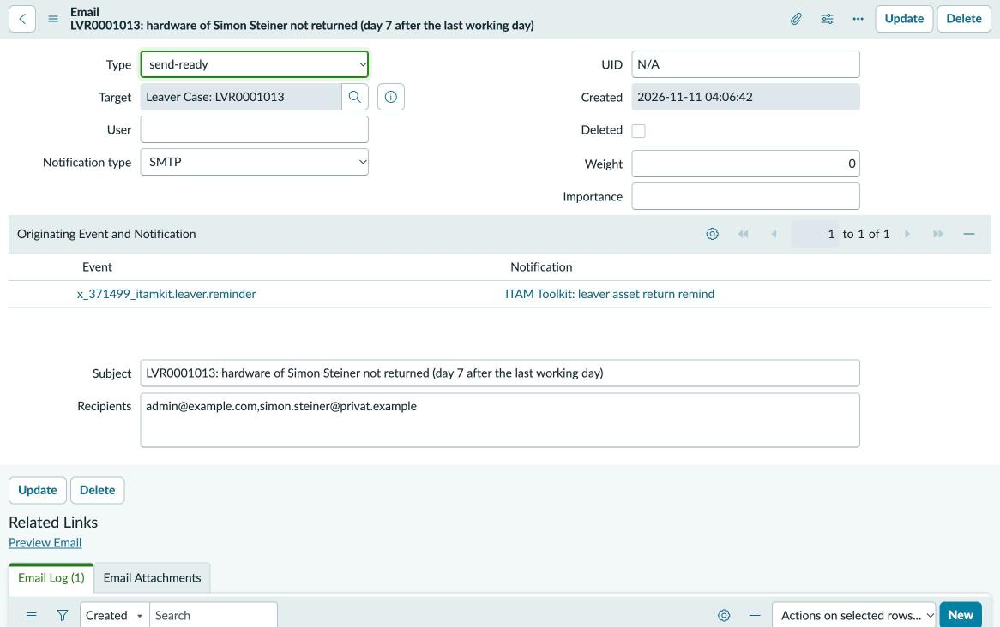 |

**Compared with HAM Pro «Reclaim Asset»** (plugin `sn_hamp`, not installed on the PDI; based on the ServiceNow documentation, not tested here):

| | ITAM Toolkit, module 1 (Core) | HAM Pro «Reclaim Asset» |
|---|---|---|
| Licence | ServiceNow Core only | Hardware Asset Management Professional |
| Start | record producer for HR, deactivation of the user, nightly sweep | catalog item «Reclaim Asset» (HR, manager, employee) |
| Per device | one `asset_task` with four outcome buttons | reclamation line per device, reclamation tasks for drop-off, pickup or shipment |
| Software | not covered | software reclamation lines for returned devices and the user |
| Leavers missed by HR | nightly sweep over inactive users with hardware | not described |
| Reminders and escalation | day 3, 7, 14, to manager and HR, private address optional | not described in the pages consulted |
| KPIs | return rate, cycle time, on time; REST and reports | not described in the pages consulted |
| Shipping, logistics | none | part of the reclamation tasks |

If HAM Pro is licensed, its reclamation is the better choice; the toolkit is for the many installations that run ITAM on Core.

### Module 2: Asset↔CI Drift & DQ Scorecard

- **Configurable rule table** (table, population and defect condition, dimension, weight, group, remediation hint) with **15 generic rules** on CIs, assets and users, no company names. Rule types: query, duplicate values, field mismatch (for example manufacturer vs. the model's manufacturer), asset/CI drift.
- **Weighted score** per scorecard (optionally per company), **nightly snapshot** with one result per rule; trend as a line report, without Performance Analytics.
- **Drift watcher:** the target state is the platform's own asset/CI install status mapping (`alm_asset_ci_state_mapping`, 52 entries). The UI action **«Drift beheben»** asks which side leads, shows a preview of exactly that change, applies it, verifies it and writes the audit log.
- **Independent check in Python** ([`loader/check_dq_scorecard.py`](loader/check_dq_scorecard.py)): its own encoded-query evaluator recomputes every rule from the raw records and compares population, defects and score; the rules that correspond to an injected error type are compared with the ground truth.

| | |
|---|---|
| Baseline (Muster AG, before the toolkit demo) | score **90.84** in ServiceNow, **90.84** recomputed in Python; 15 of 15 rules equal ([report](docs/dq_scorecard_baseline.md)) |
| Ground truth | the 7 matching generic rules find **41 of 44** injected issues of their types; the other 3 were corrected by the platform on load and are reported by the project's import check |
| Biggest gap | U01: **126 of 126** active users have no manager, so escalations in module 1 cannot reach anybody in this data |
| Drift demo | an integration user changed the status of two CIs (`loader/simulate_drift.py`); the platform did not pass it on to the assets; 2 findings, fixed once with the asset leading and once with the CI leading, 2 audit rows |
| Trend on the demo day | 90.84 → 91.11 (three leaver cases closed) → 91.00 (drift) → 91.11 (drift fixed) → 91.20 (last leaver case closed); the final snapshot recomputed in Python: 91.20, 15 of 15 rules equal ([report](docs/dq_scorecard.md)) |
| ATF test | 45 of 45 assertions passed ([test log](docs/screenshots/20_toolkit_atf_drift_log.jpg)) |

| Rule table | Snapshot with one result per rule | «Drift beheben» with the preview of the chosen side |
|---|---|---|
| 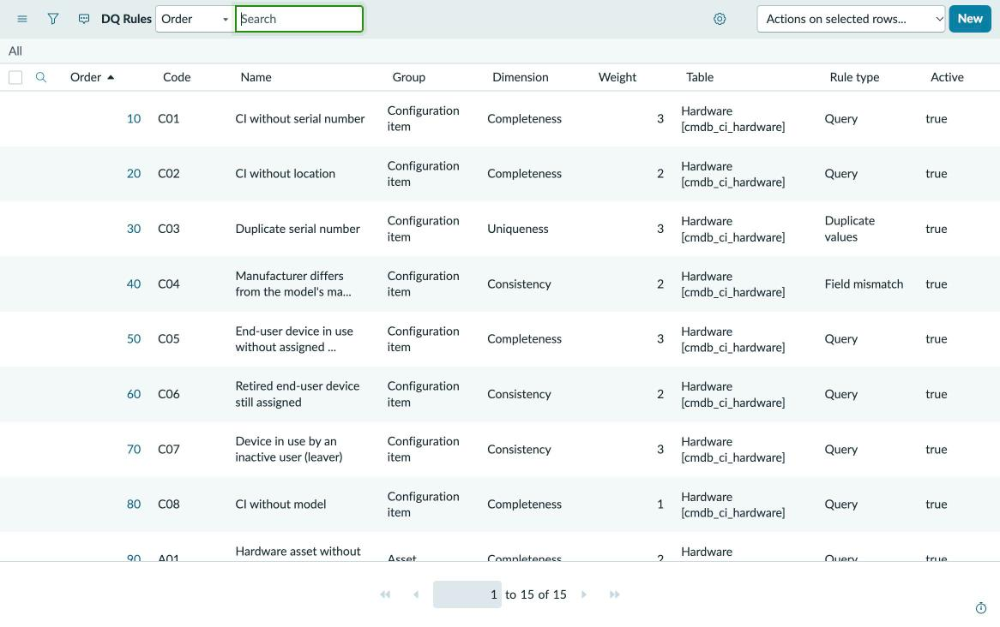 | 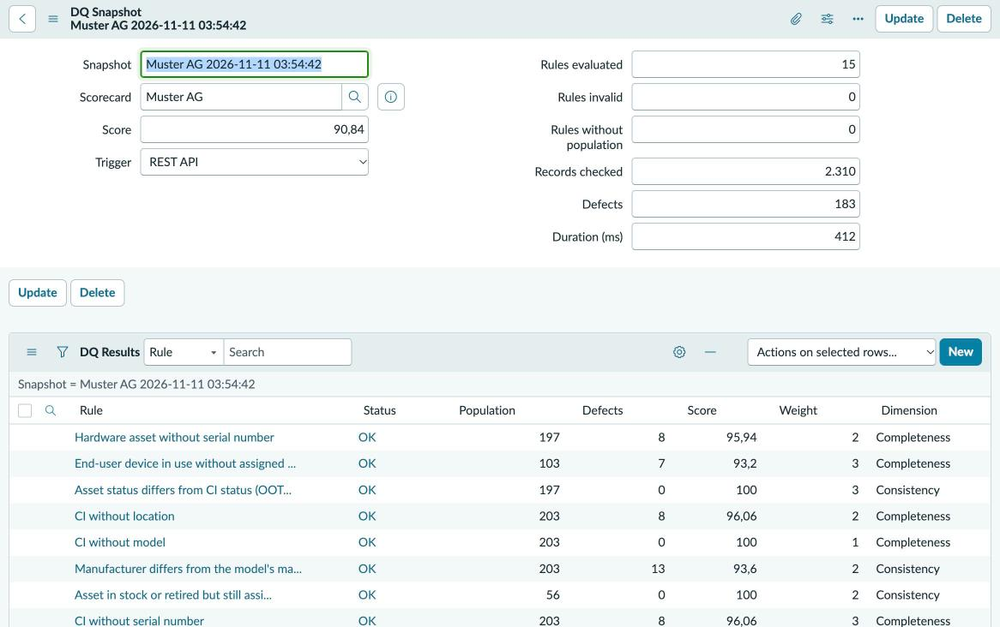 | 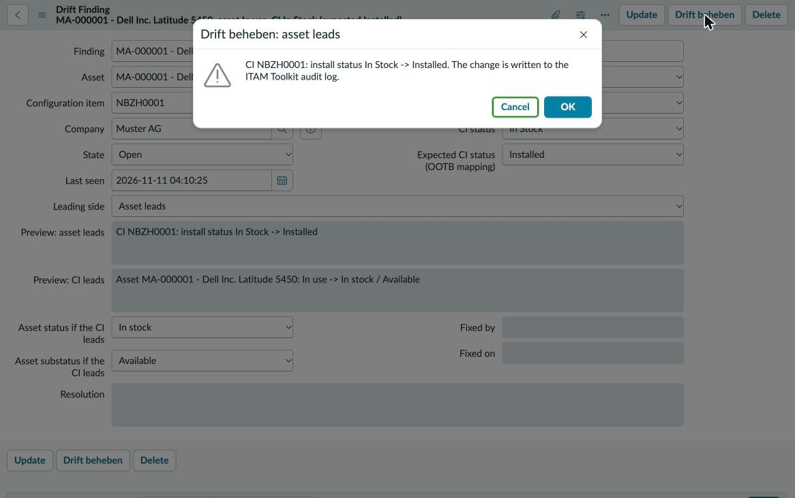 |

**Compared with existing options** (none installed on the PDI; based on the ServiceNow documentation and the vendor's pages):

| | ITAM Toolkit, module 2 | CMDB success advisor for HAM | RapDev Asset & CI Insights | CSDM Data Foundations, «Crawl» |
|---|---|---|---|---|
| Needs | Core | HAM Pro (HAM licence categories) | free Store app | CMDB Workspace, no HAM licence |
| Asset/CI status mismatch | yes, against the OOTB mapping, with findings | yes (install status vs. asset state) | not described | yes, life-cycle values of CI, asset and IBI |
| Missing fields, duplicates | configurable rules | missing model, serial, location; duplicates | duplicates, broken references, orphaned records | fixed foundation indicators |
| Own rules and weights | yes, rule table | no | no | no (fixed metrics with weights) |
| Fix from the finding | «Drift beheben» with preview, leading side, audit log | not described in the pages consulted | tags records with findings | remediation playbooks (Now Support) |
| Score over time | weighted score per snapshot, line report | HAM dashboard indicators | dashboard | compliance per indicator |
| Independent recomputation | Python check against the raw records | no | no | no |

The CMDB success advisor for HAM covers most of module 2 for customers with HAM Pro; module 2 is the configurable, testable equivalent for Core, plus the fix with audit trail.

### Module 3: Catalog request flows (0.2.0)

Two Service Catalog items, each with a Flow Designer flow in the toolkit scope. The flows only orchestrate (approval, wait, branch); every step that reads or writes ITAM data is one call of the custom action «ITAM Toolkit: run request step», which runs [`ItamKitRequests`](toolkit/requests/ItamKitRequests.js) and returns the output contract. The flows run as system user, so the requester needs no rights on assets.

- **«Gerät zurückgeben oder tauschen».** The employee picks one of the devices assigned to them (the reference qualifier offers only those) and a reason: *defekt*, *Tausch*, *nicht mehr benötigt*. Approval by the manager; without a manager by the fallback group (property `requests.fallback_group`). After the approval a return task in `asset_task`, for *defekt* and *Tausch* also a replacement task. When the return task is closed complete, the asset gets the OOTB end state (*In stock / Pending repair* for defective devices, *In stock / Available* otherwise), the assignee is cleared, the CI status follows the OOTB asset/CI mapping, and the audit log records old and new values. A rejection closes the request incomplete with the approver's reason; nothing else changes.
- **«Asset-Daten oder Standort ändern».** Location, cost center or assigned user of an asset, with a justification; a catalog UI policy shows only the field for the chosen change. Approval by the asset owner (`owned_by`), else the head of the asset's department, else the fallback group. After the approval the new value is written to the asset and its CI, one audit row per record with old value, new value and the justification; a request that changes nothing answers 208. A rejection changes nothing and records the reason.

Runs on the PDI with Muster AG data (the test data has no managers, asset owners or department heads, so every demo approval went to the fallback group; the other approvers are covered by the ATF tests):

| | |
|---|---|
| Return, *defekt* (portal, MA-000036) | approved 31 s after the order; return and replacement task created; return task closed: *In stock / Pending repair*, assignee cleared, CI *Pending repair*, 3 audit rows; request closed 81 s after the order |
| Return, *nicht mehr benötigt* (MA-000050) | rejected; request *Closed Incomplete* after 22 s, asset unchanged, no audit row, reason in the work notes |
| Return, *Tausch* (MA-000109) | the first run skipped the approval (bug, see findings); restarted after the fix, approved, return task closed: *In stock / Available*, 3 audit rows |
| Location change (portal, MA-000003, Zürich → Bern) | approved; location of asset and CI set to «Muster AG Bern», 2 audit rows with old and new value and the justification; request closed 28 s after the order |
| Reassignment (MA-000189) | rejected; request *Closed Incomplete* after 20 s, asset unchanged, no audit row |
| ATF tests | «Gerät zurückgeben oder tauschen» 29 of 29 ([test log](docs/screenshots/21_toolkit_atf_device_return_log.jpg)), «Asset-Daten oder Standort ändern» 20 of 20 ([test log](docs/screenshots/22_toolkit_atf_asset_change_log.jpg)) assertions passed (happy path and rejection each) |

The times are demo times with the approver at the screen, not process times.

| Return of a defective device: portal order, approval, return task, asset in stock for repair | Location change: portal order with the UI policy, approval, asset and CI, audit log |
|---|---|
| 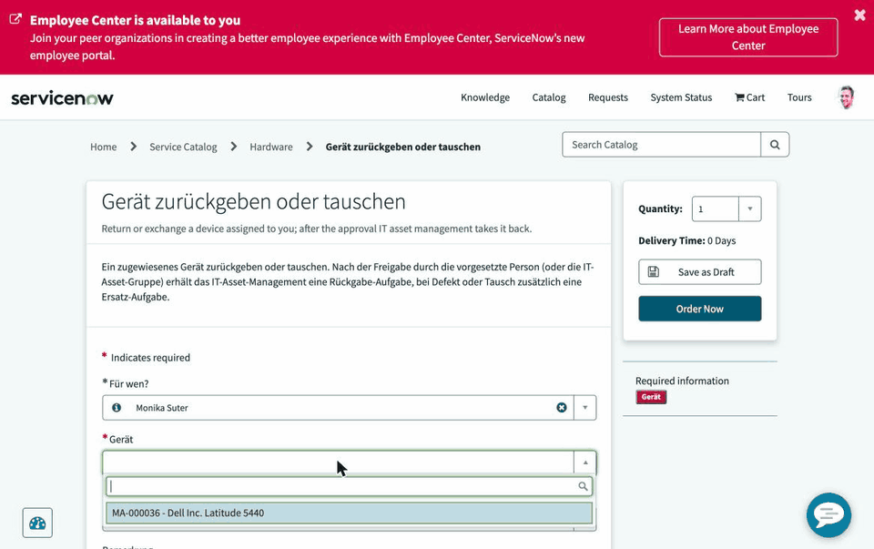 | 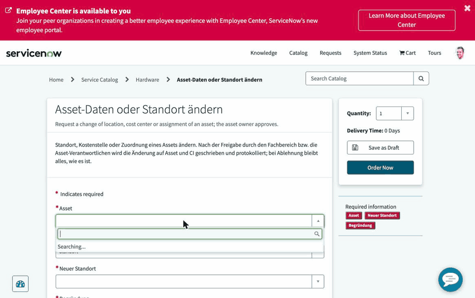 |

| Flow «Gerät zurückgeben oder tauschen» | Flow «Asset-Daten oder Standort ändern» |
|---|---|
| 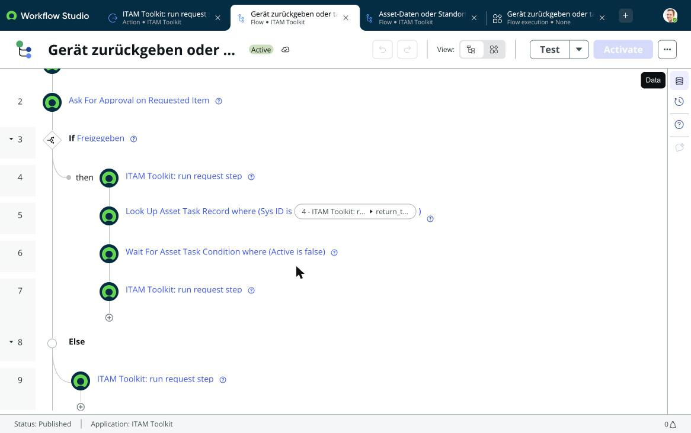 | 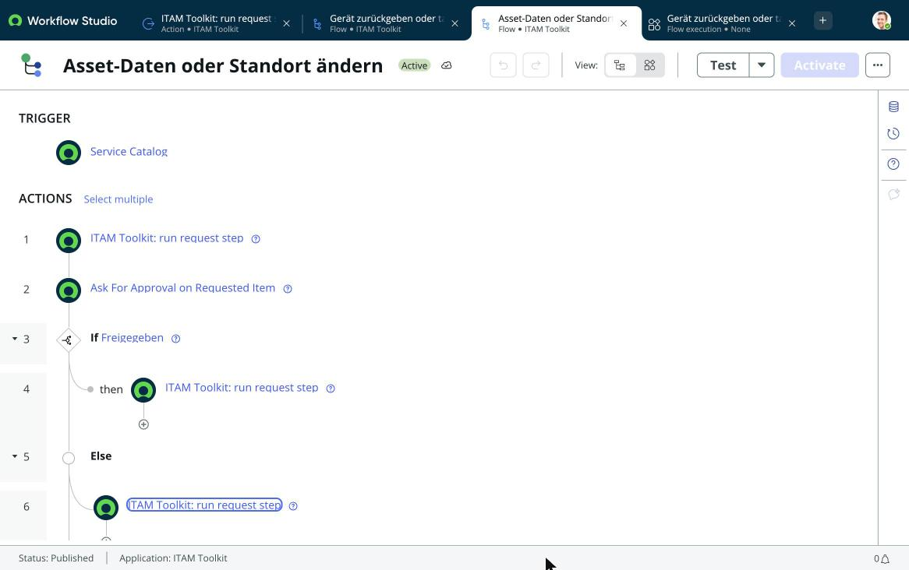 |

### Demo

| 1. HR reports a leaver the sweep had already found: the open case is updated, not duplicated; the device comes back and the case closes | 2. Drift fixed with the asset leading and with the CI leading |
|---|---|
| 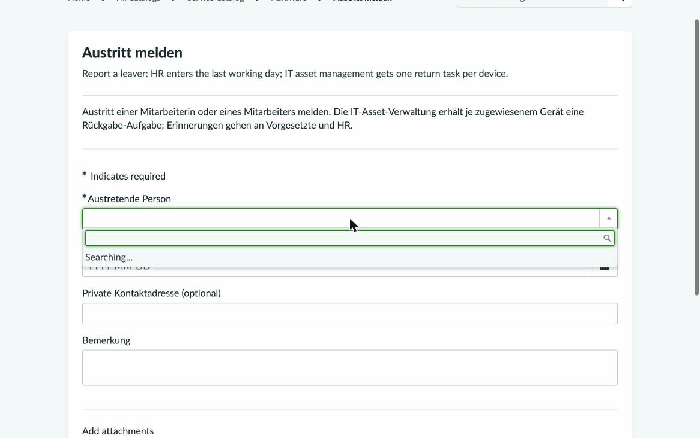 | 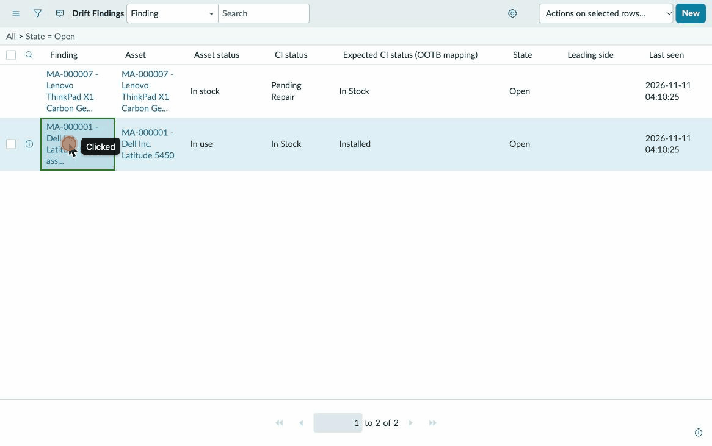 |

Install: import [`servicenow/update_sets/ITAM_Toolkit_0.1.0.xml`](servicenow/update_sets/ITAM_Toolkit_0.1.0.xml), run the fix script «ITAM Toolkit: seed generic DQ rules», assign the roles, run the two ATF tests (details in the catalog). For module 3 import [`servicenow/update_sets/ITAM_Toolkit_0.2.0.xml`](servicenow/update_sets/ITAM_Toolkit_0.2.0.xml) afterwards, set the property `requests.fallback_group` to the name of the approving group and run the two request ATF tests.

ATF results on the PDI, all four toolkit tests run again on 11 Nov 2026 after the 0.2.0 release (end of each test log):

| Leaver asset return: 76 of 76 | Asset/CI drift and DQ scorecard: 45 of 45 |
|---|---|
| 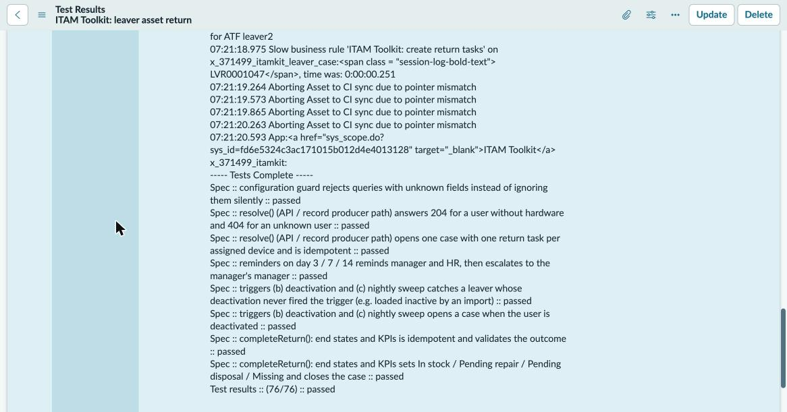 | 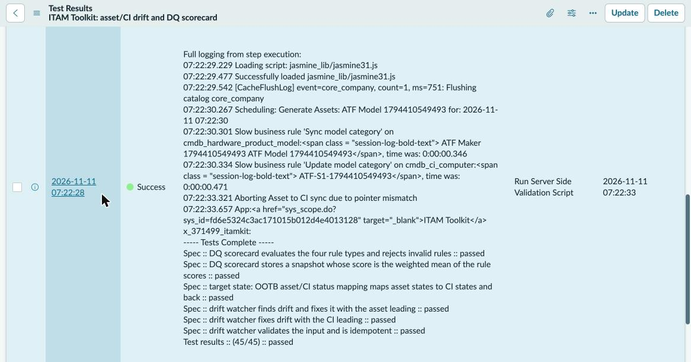 |

| Gerät zurückgeben oder tauschen: 29 of 29 | Asset-Daten oder Standort ändern: 20 of 20 |
|---|---|
| 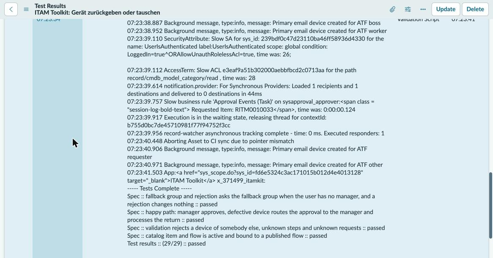 | 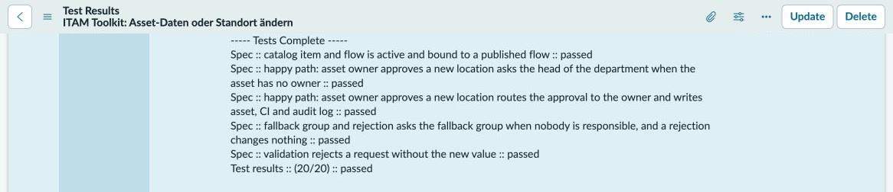 |

## Findings on the platform

Things the run made visible, each verified on the instance:

- **A matching serial number is not enough when name and MAC contradict it.** Three scan records carried the serial number in another spelling (lowercase, trailing space), an FQDN name and the MAC of a second network card. The transform script normalizes serials, so they are identical afterwards, yet the IRE still created separate CIs for them; in dry runs a payload with the serial number alone did match. 9 of 12 scan duplicates were merged, the other 3 are caught by report «ITAM DQ 7». The lesson: clean, consistent identifiers per source matter more than extra matching logic.
- **Reconciliation rules protect attributes.** The network scan reports FQDN host names. A reconciliation rule makes the inventory export authoritative for name, user, location and other organisational attributes, so a scan update does not overwrite them.
- **Assets are created from CIs automatically**, asynchronously by the job «Asset – Create asset delayed sync» (every 15 minutes), based on the model category. The 6 firewalls have no model category with an asset class, so 203 CIs became 197 assets. Deleting an asset deletes its CI as well.
- **Assets created from CIs always start as *In use*.** 61 of 197 assets therefore contradicted their CI (in stock, retired, in maintenance), and the laptop request found nothing in stock. The business rule now takes the status over from the CI; a fix script corrected the existing assets without touching the CIs. In the final run from zero the asset statuses match the CIs exactly (136 / 45 / 11 / 5).
- **The platform clears the assignee of an asset in stock** (rule «Clear Assigned To on update»). Assigning a stock device means setting *In use* and the user in the same update, which is what the flow does. The ATF test documents this behaviour.
- **ATF execution is disabled by default** on a developer instance (`sn_atf.runner.enabled`).
- **Company names match case-insensitively.** The variant «LENOVO» is matched to the existing «Lenovo» on load, so it never shows up in the CMDB. Only an exact comparison in the import check reports it.
- **The platform fills a missing location from the assigned user.** Convenient, but it hides a gap in the source; the import check reports it before it disappears.
- **Import set rows are temporary.** The import check writes into the import set rows, which the platform's cleanup job deletes after a few days by default. For lasting evidence the findings would go into a table of their own (see production notes); here `docs/data_quality.md` and `docs/import_run.md` keep the result.
- **Hardware Asset Management (sn_hamp) is not available on a developer instance**, and Software Asset Management Professional is not active (its plugins are inactive, `samp_*` tables missing). This project therefore works with the base CMDB, asset and license tables.
- **The license type of a software model is a reference** (`cmdb_sw_license_calculation`: *Per named user*, *Per workstation*, ...), and the integration user may not read it. The license position is therefore calculated on the platform and exposed through a read-only Scripted REST API instead of widening the integration user's rights.
- **Column types must be given by name.** Columns created through the Table API with the `sys_glide_object` sys_id as type were silently created as strings: numbers were stored as «20.0» and sorted as text. Fixed by recreating the three integer columns with type `integer` (and setting the staging columns to `string`).
- **Scheduled jobs are not captured by update sets** on this release (`sysauto_script` has `update_synch=false`). The job «ITAM: Lizenzposition berechnen» was added to the update set explicitly; without that it would be missing on the next instance.
- **A CI status written by an integration does not reach the asset.** The platform syncs the asset status to the CI, not back. The ITAM Toolkit therefore compares both against the platform's own status mapping; on the PDI's demo data (not Muster AG) 120 of 1,091 assets drift.
- **Runtime access tracking «Enforcing» gates Glide APIs too**, one by one (`GlideRecord.setValue`, `.insert`, `.update`, `Glide API: properties`, `ScopedGlideElement`), and a denied aggregate call returned a wrong count without an error. The toolkit runs in «Tracking» with all privileges declared; details in [`docs/limitations.md`](docs/limitations.md).
- **Numbers from server-side JavaScript need care**: Rhino stores `20` as «20.0» in a string field, and a Scripted REST API that returns an object sends `5.0`; `String(...)` and `JSON.stringify` avoid both.
- **A record pill reaches an action's script step as a GlideRecord**, even when the action input is a string: `String(inputs.request)` gave «[object GlideRecord]», the step answered 404 and the approval had nobody to ask. The action now reads `getUniqueValue()` when it gets a record.
- **«Ask For Approval» needs typed pills.** The rule stores users and groups separately (`ApprovesAnyU[…]G[…]`); a group sys_id coming from a string output was not resolved as a group, and the flow log said «Skipped due to no valid approvers». With the action outputs typed as references to `sys_user` and `sys_user_group` the same rule asks the group.
- **A flow run in the foreground stops at an approval with an exception** («The current execution is in the waiting state»), not with a result. The approval records exist at that point; the ATF helper catches it and looks up the waiting flow context.
- **The Table API stored catalog UI policy actions without policy and variable.** The three records were created, but `ui_policy` and `catalog_variable` stayed empty, so the portal showed every field and none was mandatory. Set with a background script; the update set holds the final records.

## Quickstart

Requirements: Python 3.11+, a ServiceNow developer instance with the configuration described in `servicenow/` and an integration user.

```bash
cp .env.example .env    # fill in instance URL and integration user
python3 loader/check_connection.py
python3 loader/load_testdata.py
python3 loader/check_data_quality.py
python3 loader/check_license_position.py
python3 loader/check_dq_scorecard.py   # ITAM Toolkit scorecard vs. raw records (needs the toolkit role)
```

Development:

```bash
python3 -m venv .venv && .venv/bin/pip install -r requirements-dev.txt
.venv/bin/ruff check . && .venv/bin/pytest -q
python3 testdata/generate_testdata.py   # same seed, byte-identical output
```

## Repository layout

```
testdata/     generator and generated CSV files, ground_truth.json
loader/       REST client, Import Set loader, data quality and license position checks, reset script
servicenow/   scripts that run on the instance, update sets as XML
assistant/    read-only AI assistant (guardrails, tools, Claude loop)
toolkit/      ITAM Toolkit scoped app: script includes, rules, jobs, REST, ATF, bundle builder and deployer
docs/         import run, data quality, license position, toolkit catalog and limitations, screenshots, demo GIFs
tests/        pytest suite (generator, staging definitions, scripts, license position, assistant guardrails, toolkit)
```

## What I would do in production

- **Real sources instead of CSV:** Service Graph Connectors (e.g. SCCM, Intune) or Discovery, so identification data comes from the devices themselves.
- **IntegrationHub ETL / Robust Transform Engine** instead of calling the IRE from a transform script; same identification rules, less custom code.
- **Normalization:** Hardware and software normalization (HAM/SAM Pro) instead of tolerating manufacturer variants; a lookup of canonical names before load.
- **Reconciliation per source and attribute**, plus staleness rules, so the most trustworthy source wins per field.
- **CMDB Health** (completeness, correctness, compliance) and de-duplication tasks instead of hand-made reports.
- **Source data checks with lasting evidence:** findings of the import check in a log table of their own (row, rule, value, date) instead of the temporary import set rows, with a notification to the owner of the source.
- **Least privilege and secrets:** one integration user per interface, OAuth instead of basic auth, secrets in a vault.
- **Change management for configuration:** scoped app or update sets in source control, ATF tests, promotion via pipeline.
- **Operations:** scheduled imports, alerting on transform errors, cleanup job for old import sets.
- **SAM Pro** instead of the hand-made position: automatic normalization against the content library, license metrics per publisher, reconciliation with entitlements per user and device, and usage data instead of installations only.
- **AI assistant:** a dedicated read-only user with its own role and ACLs, OAuth, the tools as an MCP server, an eval set of real questions with expected answers before going live, and the audit log in a central place.

## Limits

- Personal developer instance (PDI); it is reclaimed after inactivity, so configuration is kept in this repository.
- License metrics and prices in the test data are simplified and fictitious; the license position counts installations, not actual use.
- No test user has two computers, so counting *Per named user* (distinct users) never differs from counting devices in this data; that part of `ItamLicensePosition` is not discriminated by the test data.
- The standalone Claude API loop in `assistant.py` has not been run; the questions were answered from Claude Code through the same read-only tools.
- The ITAM Toolkit demo changed Muster AG data (the four leavers' devices: three returned, one reported lost; two CI statuses changed and fixed); see [`docs/limitations.md`](docs/limitations.md).
- All names, serial numbers and addresses are invented. The e-mail domain `muster.example` uses the reserved `.example` TLD.
