# ServiceNow ITAM Demo

[](https://github.com/itam-automation/servicenow-itam-demo/actions/workflows/ci.yml)

> **Kurzfassung:** Portfolio-Projekt zu IT Asset Management auf einer persönlichen ServiceNow-Entwicklerinstanz (Release Brazil). Erfundene Testdaten der «Muster AG» (200 Geräte, 130 Benutzer, zwei Datenquellen) laufen über Import Sets mit Transform Maps in die CMDB. Die Identification and Reconciliation Engine (IRE) führt Dubletten aus dem Netzwerk-Scan zusammen. Reports in ServiceNow und ein Python-Check messen die Datenqualität gegen eine bekannte Wahrheit: **50 von 53 eingebauten Fehlern erkannt** (9 Dubletten von der IRE zusammengeführt, 41 von den Reports gefunden); die übrigen 3 hat die Plattform schon beim Laden bereinigt, unerkannt blieb keiner. Ein Catalog Item «Laptop anfordern» mit Flow, Business Rule und ATF-Test weist Lagergeräte zu. Software Asset Management ohne SAM Pro: 582 Installationen und 8 Lizenzen ergeben in ServiceNow eine Lizenzposition je Produkt, **9 von 9 stimmen mit der bekannten Wahrheit überein**. Ein KI-Assistent beantwortet Fragen zu diesen Daten und kann technisch nur lesen. Alle Daten sind erfunden.

## Status

| # | Module | Status |
|---|---|---|
| 0 | Test data generator with injected errors (ground truth) and tests | done |
| 1 | Personal developer instance (release Brazil), integration user | done |
| 2 | CMDB load via Import Sets and Transform Maps, duplicate handling via IRE, data quality reports | **done** |
| 3 | Catalog item «Laptop anfordern» with Flow Designer, business rule, ATF test | **done** |
| 4 | Software Asset Management: installations, licenses, license position (compliance) | **done** |
| 5 | AI assistant, technically read-only | **tool layer done** and tested against the instance; answers by the model need an API key (not run yet) |

## Demo

Ordering a laptop for a Muster AG employee (MacBook Pro 14 M4), then approval by the asset management group: the flow assigns the in-stock asset MA-000096, sets it to *In use* with assignment date and creates the fulfilment task.

| 1. Order in the Service Catalog | 2. Approval, assigned asset, task |
|---|---|
| 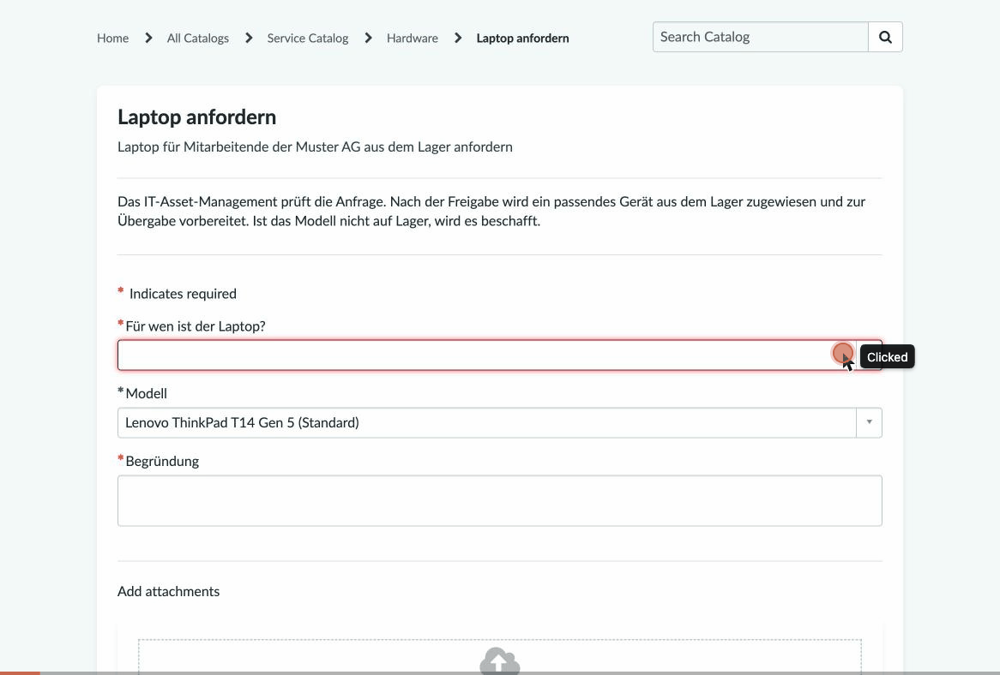 | 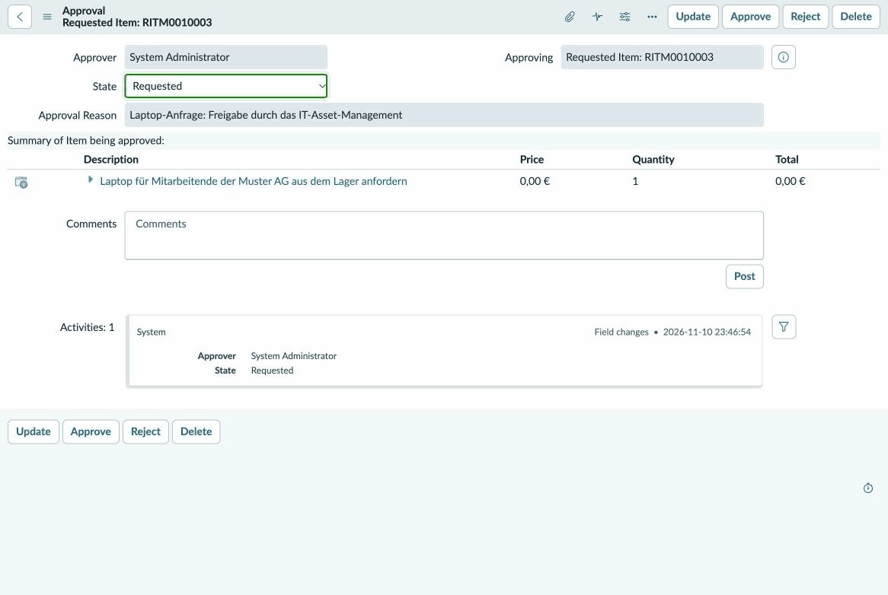 |

## The problem

In IT Asset Management the CMDB is fed by several sources: an inventory export, a network scan, procurement. Each source has its own gaps: duplicates with slightly different names or serial numbers, missing serial numbers, manufacturer spelling variants («DELL», «HP Inc.»), devices still assigned to people who have left. Without a repeatable load process and a measurable quality check, «the CMDB is clean» remains an opinion.

## The solution

| Step | What | Where |
|---|---|---|
| 1 | Generate test data with **known, injected errors** (ground truth) | `testdata/generate_testdata.py` |
| 2 | Load master data and devices through **Import Sets with Transform Maps** (Import Set API, one import set per file) | `loader/load_testdata.py`, `loader/staging.py` |
| 3 | Route every device row through the **IRE** in an onBefore transform script; normalize serial numbers; a reconciliation rule makes the inventory authoritative for organisational attributes | `servicenow/device_transform_onbefore.js` |
| 4 | Measure **data quality** in ServiceNow (10 reports) and against the ground truth (Python check, result as a number) | `loader/check_data_quality.py`, `docs/data_quality.md` |
| 5 | Reset the instance safely (select by creator, count first, verify totals) | `loader/reset_testdata.py` |
| 6 | Request a laptop in the **Service Catalog**: approval by the asset management group, an in-stock device of the requested model is assigned, a fulfilment task is created (or a procurement task if nothing is in stock); a **business rule** keeps the asset lifecycle consistent; an **ATF test** checks it | Flow Designer, `servicenow/business_rule_asset_lifecycle.js`, `servicenow/atf_lifecycle_test.js` |
| 7 | **Software asset management** without SAM Pro: software models and packages (normalization), installations, licenses; a script include calculates the **license position** per product, a check compares it with the ground truth | `servicenow/license_position.js`, `loader/check_license_position.py` |
| 8 | **AI assistant** that answers questions about this data with Claude and three tools that can only read | `assistant/` |

## Architecture

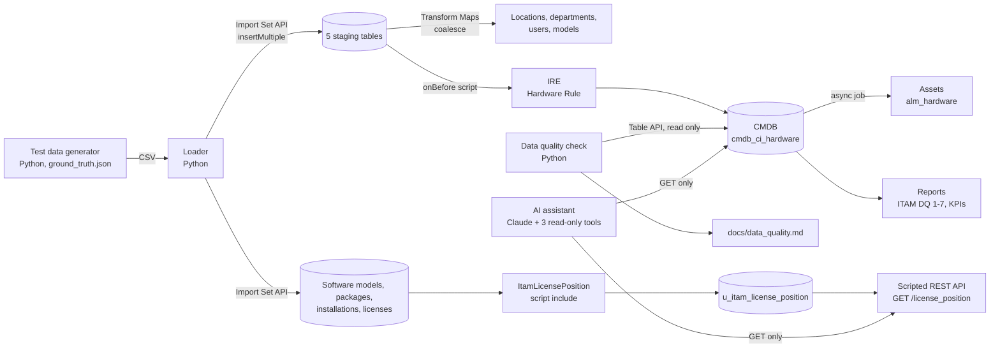

The loader uses a dedicated integration user (`svc_itam_loader`, machine identity, web service access only). Credentials live in a local `.env` file that is never committed.

## Results

Final run on 11 Nov 2026, starting from an instance without any Muster AG data:

**50 of 53 injected data quality issues detected**: 9 scan duplicates merged by the IRE, 41 issues found by the reports. The remaining 3 were already resolved by the platform on load (location taken over from the assigned user; «LENOVO» matched to the existing «Lenovo»). None went undetected. Per-issue details: [`docs/data_quality.md`](docs/data_quality.md).

| | |
|---|---|
| Import | 6 import sets, 392 rows, 0 errors: 5 locations, 9 departments, 130 users, 36 models, 200 + 12 devices ([`docs/import_run.md`](docs/import_run.md)) |
| IRE, inventory export | 200 CIs created |
| IRE, network scan | 12 rows: 9 merged into existing CIs (6 via serial number + MAC, 3 via name + MAC), 3 created as separate CIs because name and MAC contradict the matching serial number; all 3 are listed by report «ITAM DQ 7» |
| CMDB | 203 CIs of Muster AG; 197 hardware assets created automatically from them (the 6 firewalls have no asset class) |
| KPIs (in use) | warranty ending in 2027: 22, warranty expired: 56, still on Windows 10: 3; all equal to the ground truth |

| Import sets of the final run | Transform maps |
|---|---|
| 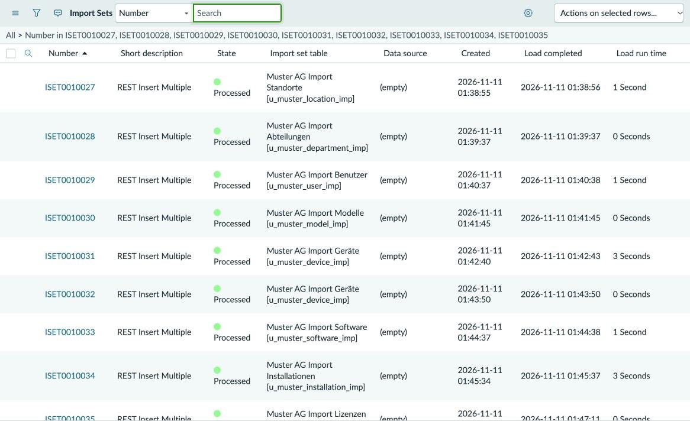 | 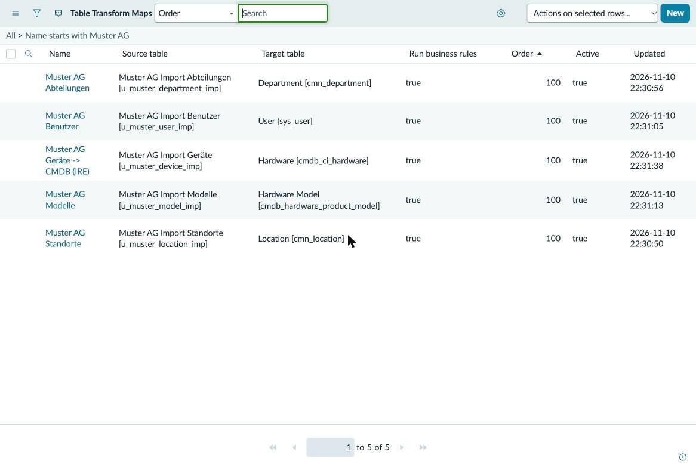 |
| **onBefore script calling the IRE** | **Report «ITAM DQ 7»: scan-only CIs (duplicate candidates)** |
| 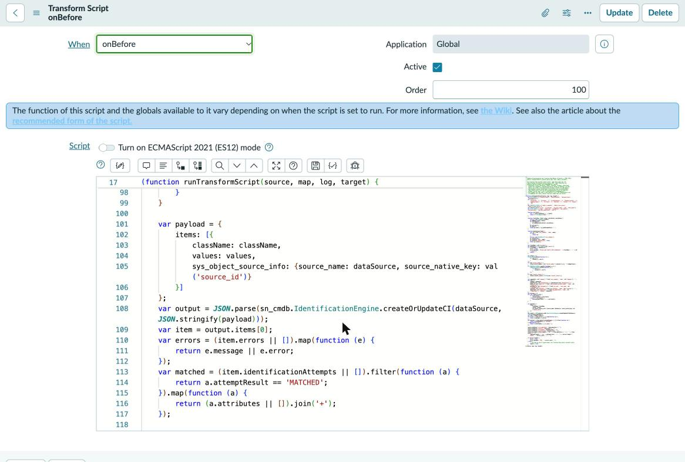 | 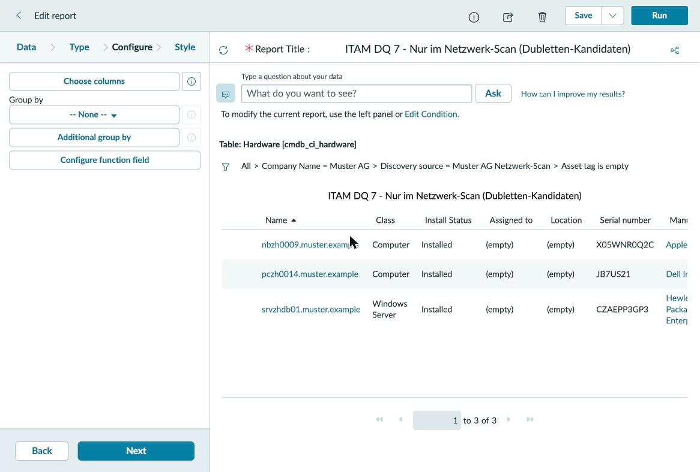 |
| **CMDB grouped by manufacturer: spelling variants** | |
| 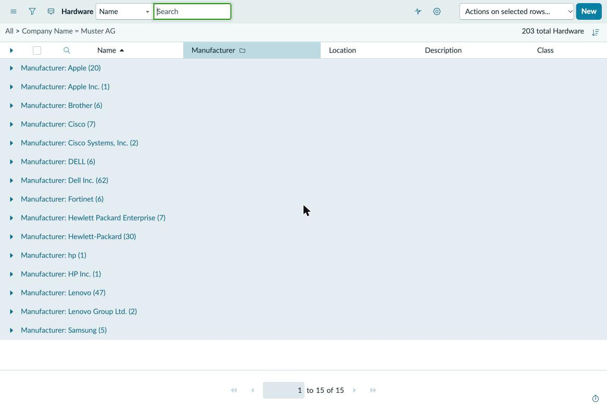 | |

## Laptop request (milestone 2)

Catalog item **«Laptop anfordern»** (variables: requested for, model, justification) with the flow **«Laptop anfordern»**:

1. Get catalog variables
2. Ask for approval: group «Muster AG IT-Asset-Management», anyone approves
3. If approved: look up the first hardware asset in stock whose name contains the requested model
4. If found: set the asset to *In use* and assign it to the requester, create the task «Laptop aus dem Lager vorbereiten und übergeben»
5. Otherwise: create the task «Laptop nicht auf Lager: Modell beschaffen»

Business rule **«ITAM: Lifecycle-Status Hardware-Asset»** (`alm_hardware`, before insert/update) adds what the platform rules do not cover: a new asset takes over the lifecycle status of its CI, and an asset that goes into use gets its assignment date. A one-time fix script aligned the 61 existing assets.

ATF test **«ITAM: Lifecycle-Status Hardware-Asset»**: 4 Jasmine specs, 9/9 assertions passed, changes rolled back automatically.

End-to-end run: request REQ0010002 for a ThinkPad X1 Carbon Gen 11 was approved; asset MA-000007 moved from *In stock* to *In use*, assigned to the requester with assignment date, the linked CI followed (*Installed*), task SCTASK0010002 was created for the asset management group.

| Flow «Laptop anfordern» | ATF test result |
|---|---|
| 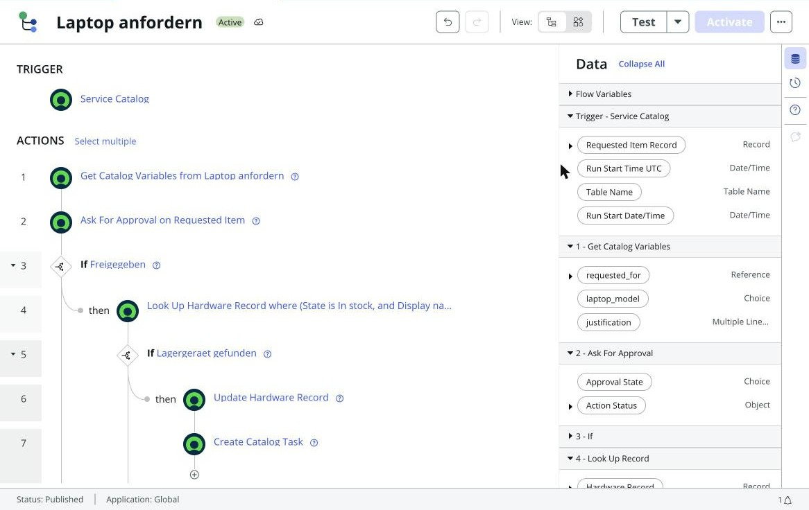 | 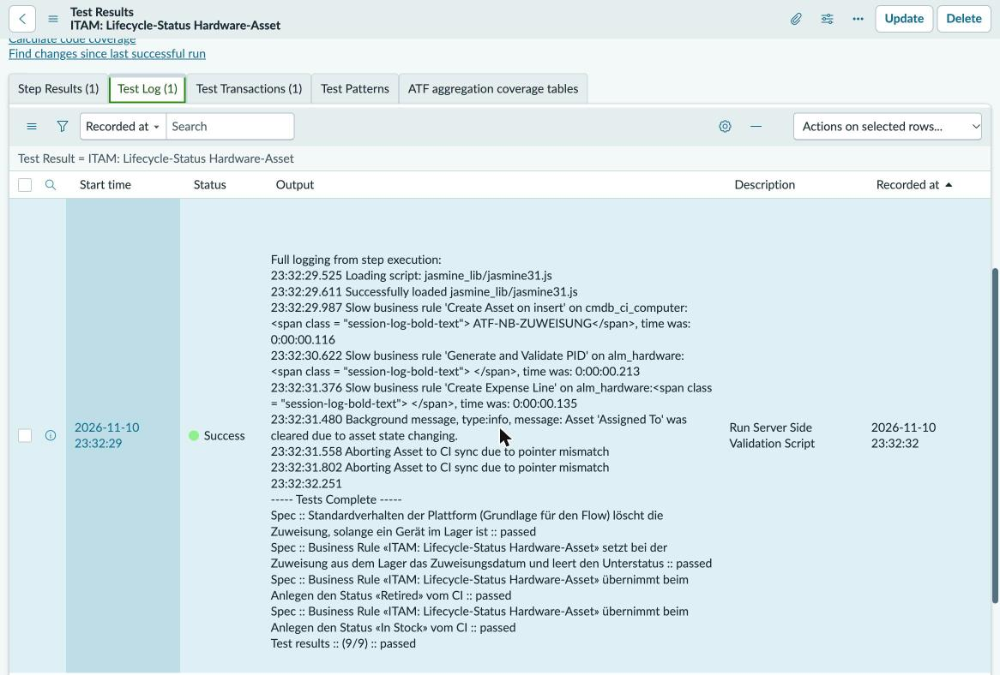 |

## Software asset management (milestone 3)

Software Asset Management Professional (SAM Pro) is not active on a developer instance, so the license position is built on the base tables, transparently and checked against the ground truth:

| Step | Table | Result |
|---|---|---|
| Software catalog (normalized products) | `cmdb_software_product_model` | 22 models, license type from the platform (*Per named user*, *Per workstation*, empty for free software) |
| Raw names and versions, as an inventory tool reports them | `cmdb_ci_spkg` | 27 packages, each linked to its model (`model_id`): the normalization step SAM Pro would do |
| Installations on Muster AG devices | `cmdb_software_instance` | 582 |
| Licenses (purchased rights, cost, subscription end) | `alm_license` | 8 |
| License position per product | `u_itam_license_position` | 9 products, recalculated after every license import (onComplete script) and daily (scheduled job) |

All of it is loaded through Import Sets (three more staging tables and transform maps); the field maps call the script include `MusterSamImport`, and a rerun changes nothing (coalesce). The script include **`ItamLicensePosition`** counts usage per license type (*Per workstation*: devices with an installation; *Per named user*: distinct users of those devices, a device without a user counts once) and compares it with the rights.

**Result: 9 of 9 license positions match the ground truth**, both as calculated by ServiceNow and as recalculated by `loader/check_license_position.py` from the raw data ([`docs/license_position.md`](docs/license_position.md)):

| Status | Products |
|---|---|
| no license | WinRAR (10 devices) |
| under-licensed | Acrobat Pro (-4), Visio Plan 2 (-2), PyCharm Professional (-1) |
| balanced | AutoCAD LT |
| unused (shelfware) | Project Professional 2021 (1 license, 0 installations) |
| over-licensed | Microsoft 365 Apps (+5), Photoshop (+3), Snagit (+2) |

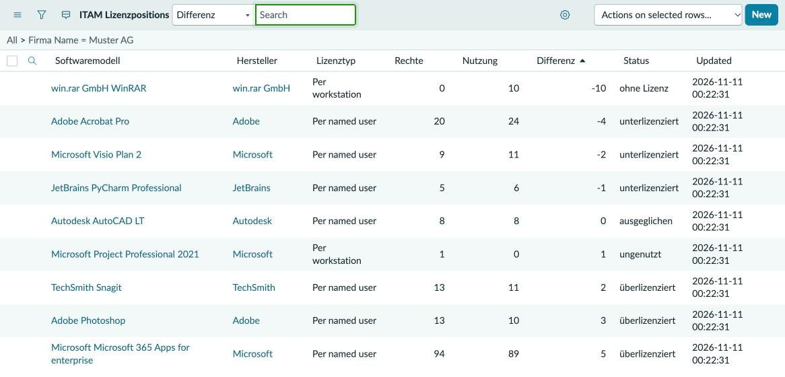

Reports «ITAM SAM 1» (license position) and «ITAM SAM 2» (products by license status) show the same table. A Scripted REST API **«ITAM Demo»** (`GET /license_position`) returns it as JSON for scripts and the assistant.

## Read-only AI assistant (milestone 3)

`assistant/assistant.py` answers questions such as «Which laptops are in stock?» or «Where are we under-licensed?» with Claude (`claude-opus-5-5`) and three tools: `search_records`, `count_records` and `get_license_position`. Read-only is enforced in code, not only in the prompt ([`assistant/readonly.py`](assistant/readonly.py)):

- **GET only.** The client has no method that writes; every request goes through one function that sends GET.
- **Allow list** of 8 tables and their fields; contact fields (e-mail, phone) are not on it.
- **Always scoped to Muster AG**: the company filter is prepended to every query; queries that could escape it (`^NQ`, a leading `OR`, `RLQUERY`) are rejected.
- **No server-side script** in queries (`javascript:`, `gs.`), and **no unknown fields**: ServiceNow silently ignores an invalid query part and then returns too many records, so every field is checked against the allow list before anything is sent.
- **Limits**: at most 100 rows per query, 10 tool calls and 8 model turns per question; every tool call is logged locally (`assistant/output/audit.jsonl`).
- The system prompt treats tool results as data, not instructions, and asks for answers backed by tool results only.

Tested without a model: 13 unit tests for the guardrails (`tests/test_assistant.py`), and the tools run against the instance (`--check-access`, `--tool ...`). Answers by the model need an `ANTHROPIC_API_KEY`; that run is still open. In operation the assistant uses its own read-only user (`SN_READONLY_USER`); for tests it can use the integration user with `--use-loader-user` and stays GET-only.

```bash
python3 assistant/assistant.py --check-access --use-loader-user
python3 assistant/assistant.py --use-loader-user --tool get_license_position
python3 assistant/assistant.py "Wo sind wir unterlizenziert?"   # needs ANTHROPIC_API_KEY and anthropic (requirements-assistant.txt)
```

## Findings on the platform

Things the run made visible, each verified on the instance:

- **A matching serial number is not enough when name and MAC contradict it.** Three scan records carried the serial number in another spelling (lowercase, trailing space), an FQDN name and the MAC of a second network card. The transform script normalizes serials, so they are identical afterwards, yet the IRE still created separate CIs for them; in dry runs a payload with the serial number alone did match. 9 of 12 scan duplicates were merged, the other 3 are caught by report «ITAM DQ 7». The lesson: clean, consistent identifiers per source matter more than extra matching logic.
- **Reconciliation rules protect attributes.** The network scan reports FQDN host names. A reconciliation rule makes the inventory export authoritative for name, user, location and other organisational attributes, so a scan update does not overwrite them.
- **Assets are created from CIs automatically**, asynchronously by the job «Asset – Create asset delayed sync» (every 15 minutes), based on the model category. The 6 firewalls have no model category with an asset class, so 203 CIs became 197 assets. Deleting an asset deletes its CI as well.
- **Assets created from CIs always start as *In use*.** 61 of 197 assets therefore contradicted their CI (in stock, retired, in maintenance), and the laptop request found nothing in stock. The business rule now takes the status over from the CI; a fix script corrected the existing assets without touching the CIs.
- **The platform clears the assignee of an asset in stock** (rule «Clear Assigned To on update»). Assigning a stock device means setting *In use* and the user in the same update, which is what the flow does. The ATF test documents this behaviour.
- **ATF execution is disabled by default** on a developer instance (`sn_atf.runner.enabled`).
- **Company names match case-insensitively.** The variant «LENOVO» was matched to the existing «Lenovo» on load, so it never became a data quality issue.
- **The platform fills a missing location from the assigned user.**
- **Hardware Asset Management (sn_hamp) is not available on a developer instance**, and Software Asset Management Professional is not active (its plugins are inactive, `samp_*` tables missing). This project therefore works with the base CMDB, asset and license tables.
- **The license type of a software model is a reference** (`cmdb_sw_license_calculation`: *Per named user*, *Per workstation*, ...), and the integration user may not read it. The license position is therefore calculated on the platform and exposed through a read-only Scripted REST API instead of widening the integration user's rights.
- **Column types must be given by name.** Columns created through the Table API with the `sys_glide_object` sys_id as type were silently created as strings: numbers were stored as «20.0» and sorted as text. Fixed by recreating the three integer columns with type `integer` (and setting the staging columns to `string`).
- **Scheduled jobs are not captured by update sets** on this release (`sysauto_script` has `update_synch=false`). The job «ITAM: Lizenzposition berechnen» was added to the update set explicitly; without that it would be missing on the next instance.
- **Numbers from server-side JavaScript need care**: Rhino stores `20` as «20.0» in a string field, and a Scripted REST API that returns an object sends `5.0`; `String(...)` and `JSON.stringify` avoid both.

## Quickstart

Requirements: Python 3.11+, a ServiceNow developer instance with the configuration described in `servicenow/` and an integration user.

```bash
cp .env.example .env    # fill in instance URL and integration user
python3 loader/check_connection.py
python3 loader/load_testdata.py
python3 loader/check_data_quality.py
python3 loader/check_license_position.py
```

Development:

```bash
python3 -m venv .venv && .venv/bin/pip install -r requirements-dev.txt
.venv/bin/ruff check . && .venv/bin/pytest -q
python3 testdata/generate_testdata.py   # same seed, byte-identical output
```

## Repository layout

```
testdata/     generator and generated CSV files, ground_truth.json
loader/       REST client, Import Set loader, data quality and license position checks, reset script
servicenow/   scripts that run on the instance, update sets as XML
assistant/    read-only AI assistant (guardrails, tools, Claude loop)
docs/         import run, data quality, license position, screenshots, demo GIFs
tests/        pytest suite (generator, staging definitions, scripts, license position, assistant guardrails)
```

## What I would do in production

- **Real sources instead of CSV:** Service Graph Connectors (e.g. SCCM, Intune) or Discovery, so identification data comes from the devices themselves.
- **IntegrationHub ETL / Robust Transform Engine** instead of calling the IRE from a transform script; same identification rules, less custom code.
- **Normalization:** Hardware and software normalization (HAM/SAM Pro) instead of tolerating manufacturer variants; a lookup of canonical names before load.
- **Reconciliation per source and attribute**, plus staleness rules, so the most trustworthy source wins per field.
- **CMDB Health** (completeness, correctness, compliance) and de-duplication tasks instead of hand-made reports.
- **Least privilege and secrets:** one integration user per interface, OAuth instead of basic auth, secrets in a vault.
- **Change management for configuration:** scoped app or update sets in source control, ATF tests, promotion via pipeline.
- **Operations:** scheduled imports, alerting on transform errors, cleanup job for old import sets.
- **SAM Pro** instead of the hand-made position: automatic normalization against the content library, license metrics per publisher, reconciliation with entitlements per user and device, and usage data instead of installations only.
- **AI assistant:** a dedicated read-only user with its own role and ACLs, OAuth, the tools as an MCP server, an eval set of real questions with expected answers before going live, and the audit log in a central place.

## Limits

- Personal developer instance (PDI); it is reclaimed after inactivity, so configuration is kept in this repository.
- License metrics and prices in the test data are simplified and fictitious; the license position counts installations, not actual use.
- The AI assistant has not answered a question with the model yet (no API key in this project so far); its tools and guardrails are tested.
- All names, serial numbers and addresses are invented. The e-mail domain `muster.example` uses the reserved `.example` TLD.
