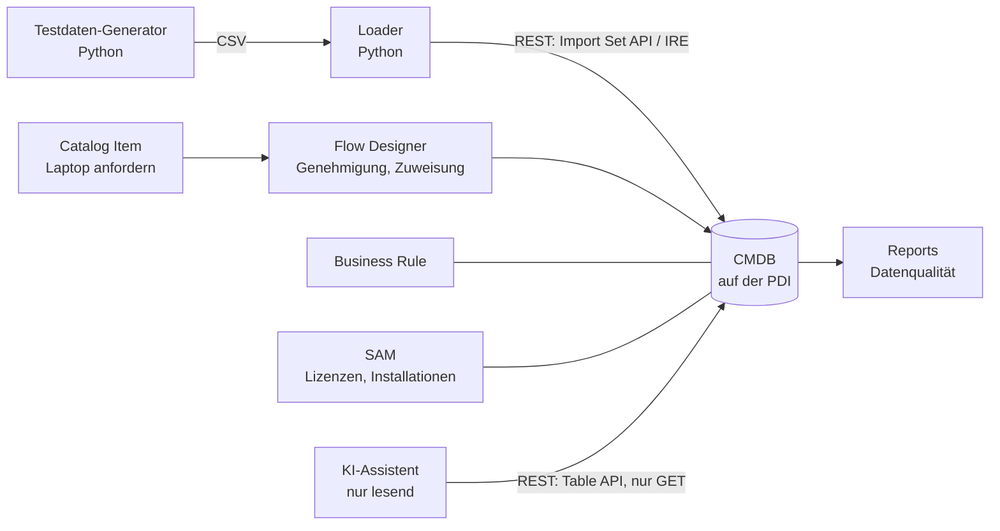

# ServiceNow ITAM Demo

Portfolio-Projekt: IT Asset Management auf einer persönlichen ServiceNow-Entwicklerinstanz (PDI). Erfundene Firma «Muster AG», erfundene Daten, echte Arbeit auf der Plattform: CMDB über REST befüllen und bereinigen, Bestellprozess mit Flow Designer, Software-Lizenzen, ein nur lesender KI-Assistent.

> Alle Daten in diesem Projekt sind frei erfunden. Echt sind nur öffentlich bekannte Hersteller- und Produktnamen, damit die Normalisierung realistisch bleibt.

## Stand

| Nr. | Baustein | Stand |
|---|---|---|
| 0 | Testdaten-Generator (Python) mit Tests | fertig, gegen die PDI geprüft |
| 1 | PDI einrichten, Grundlagen | PDI läuft (Release Brazil), Integrationsbenutzer eingerichtet, Kurs offen |
| 2 | CMDB über REST befüllen, Dublettenabgleich (IRE), Datenqualitäts-Report | offen |
| 3 | Catalog Item «Laptop anfordern», Flow, Business Rule, ATF-Test | offen |
| 4 | Software Asset Management: Lizenzrechte, Installationen, Compliance | offen |
| 5 | KI-Assistent, technisch nur lesend | offen |

## Architektur (geplant)



## Bausteine

### 1. Grundlagen
- Persönliche Entwicklerinstanz über developer.servicenow.com
- Kurs «ServiceNow Fundamentals» in der ServiceNow University

### 2. CMDB befüllen und prüfen
- **Ziel:** Die Testdaten landen über die REST-Schnittstelle in der CMDB. Dubletten aus einer zweiten Quelle werden über die Identification and Reconciliation Engine (IRE) erkannt. Ein Report zeigt die Datenqualität.
- **Prüfbar:** Der Generator schreibt mit `ground_truth.json` auf, welche Fehler er eingebaut hat. Der Report in ServiceNow muss genau diese finden.
- **Nachweis:** folgt (Code in `loader/`, Screenshots in `docs/screenshots/`)

### 3. Catalog Item «Laptop anfordern»
- **Ziel:** Bestellung mit Genehmigung durch die vorgesetzte Person, Zuweisung eines Lagergeräts, Wechsel des Lifecycle-Status. Dazu eine Business Rule in JavaScript und ein automatisierter Test (ATF).
- **Nachweis:** folgt (Skripte und Update Set in `servicenow/`)

### 4. Software Asset Management
- **Ziel:** Lizenzrechte und Installationen erfassen, Compliance-Übersicht (unter- und überlizenziert, Installationen ohne Lizenz).
- **Nachweis:** folgt

### 5. KI-Assistent, nur lesend
- **Ziel:** Beantwortet Fragen zur CMDB, zum Beispiel «Bei welchen Geräten endet die Garantie 2027?».
- **Nur lesend, technisch abgesichert:** eigener Benutzer in der Instanz nur mit Leserechten, Zugriff nur über GET. Antworten nur aus abgefragten Daten.
- **Nachweis:** folgt (Code in `assistant/`)

## Testdaten

Der Generator braucht nur Python 3 ohne Zusatzpakete. Gleicher Seed und gleicher Stichtag ergeben byte-genau dieselben Dateien.

```bash
python3 testdata/generate_testdata.py
```

```bash
python3 testdata/generate_testdata.py --seed 7 --count 300 --reference-date 2026-11-11 --out /pfad/zum/ordner
```

Ausgabe in `testdata/output/` (Stand: Seed 42, Stichtag 11.11.2026):

| Datei | Inhalt |
|---|---|
| `locations.csv` | 5 Standorte in der Schweiz |
| `departments.csv` | 9 Abteilungen mit Kostenstellen |
| `users.csv` | 130 Benutzer, davon 4 inaktiv |
| `models.csv` | 36 Hardware-Modelle |
| `devices.csv` | 200 Geräte aus dem Inventar-Export und 12 Dubletten aus einem Netzwerk-Scan |
| `software.csv` | 22 Softwareprodukte mit Rohnamen und Lizenzmetrik |
| `installations.csv` | 582 Installationen auf Laptops und Desktops |
| `entitlements.csv` | 8 Lizenzrechte |
| `ground_truth.json` | eingebaute Fehler, Kennzahlen, erwartete Lizenzbilanz |

Geräte: 110 Laptops, 35 Desktops, 18 Server, 10 Drucker, 15 Netzwerkgeräte, 12 Smartphones. Status: 139 Installed, 5 In Maintenance, 11 In Stock, 45 Retired.

Bewusst eingebaute Fehler:

| Anzahl | Fehler |
|---:|---|
| 8 | Seriennummer fehlt |
| 6 | Standort fehlt |
| 15 | Herstellername in abweichender Schreibweise (zum Beispiel «DELL» statt «Dell Inc.», «HP» statt «Hewlett-Packard») |
| 5 | Endgerät in Betrieb ohne Benutzer |
| 3 | Ausgemustertes Endgerät noch einem Benutzer zugewiesen |
| 4 | Gerät in Betrieb bei inaktivem Benutzer (Austritt nicht verarbeitet) |
| 6 | Dublette: gleiche Seriennummer, Name als FQDN |
| 3 | Dublette: Seriennummer in anderer Schreibweise, andere MAC, keine IP |
| 3 | Dublette: gleicher Name, keine Seriennummer |

Die drei Dublettenarten sind auf die Hardware Rule der IRE abgestimmt: Die erste trifft die Regel «Seriennummer», die dritte die Regel «Name». Bei der zweiten bleibt nur die Seriennummer in anderer Schreibweise, weil MAC und IP fehlen bzw. abweichen. Ob die IRE sie trotzdem erkennt, ist der eigentliche Test; das Ergebnis wird hier dokumentiert.

Herstellernamen: Die Normschreibweise entspricht den Herstellern, die in der PDI schon existieren («Dell Inc.», «Hewlett-Packard», «Lenovo», «Apple», «Cisco», «Samsung», «Brother»). Alle Datensätze tragen `company = Muster AG`, damit Reports sie von den Demo-Daten der PDI trennen.

Dazu Kennzahlen, die sich aus den Daten ergeben (Geräte in Betrieb): Garantieende 2027 bei 22 Geräten, Garantie abgelaufen bei 56, Windows 10 noch auf 3 Geräten. Lizenzbilanz: 3 Produkte unterlizenziert, 3 überlizenziert, 1 ausgeglichen, 1 ohne Lizenz (WinRAR), 1 gekauft, aber nirgends installiert (Project Professional).

Tests:

```bash
python3 -m unittest discover -s tests -v
```

Die Tests prüfen unter anderem, dass die Fehlerliste genau die fehlerhaften Datensätze nennt (keine fehlenden, keine zufällig zusätzlichen) und dass die Lizenznutzung unabhängig nachgezählt dasselbe ergibt.

## Projektstruktur

```
.
├── README.md
├── .env.example          Vorlage für Zugangsdaten (die echte .env bleibt lokal)
├── testdata/
│   ├── generate_testdata.py
│   └── output/           erzeugte CSV-Dateien und ground_truth.json
├── loader/               REST-Loader (Baustein 2), check_connection.py
├── servicenow/           Skripte und Update Sets aus der Instanz (Bausteine 2 bis 4)
├── assistant/            KI-Assistent (Baustein 5)
├── docs/
│   └── screenshots/
└── tests/
```

## Einrichtung

1. Python 3 (getestet mit 3.14).
2. In der Instanz einen Integrationsbenutzer anlegen, nicht admin verwenden:
   - User ID `svc_itam_loader`, Identity type «Machine», «Web service access only» aktiv (keine Anmeldung an der Oberfläche)
   - Rollen `sn_cmdb_editor` (IRE-Endpunkt, CMDB schreiben), `import_transformer` und `import_set_loader` (Import Set API)
3. `.env.example` nach `.env` kopieren und selbst ausfüllen. Die `.env` steht in `.gitignore`.
4. Verbindung prüfen (nur lesende Abfragen, gibt das Passwort nie aus):

```bash
python3 loader/check_connection.py
```

## Befund auf der Entwicklerinstanz

Geprüft am 11.11.2026 auf der eigenen PDI, Release Brazil (Patch 1, Hotfix 1), nur lesend über die Table API:

- **Demo-Daten:** Die PDI enthält bereits 855 Computer, 643 Benutzer und 427 Standorte. Die Testdaten werden deshalb über `company = Muster AG` getrennt.
- **Felder und Statuswerte:** Alle verwendeten Felder existieren auf `cmdb_ci_computer`. `install_status`: 1 Installed, 2 On Order, 3 In Maintenance, 4 Pending Install, 5 Pending Repair, 6 In Stock, 7 Retired, 8 Stolen, 100 Absent.
- **Klassen:** Computer, Windows-/Linux-Server, Drucker, IP Switch und IP Firewall sind vorhanden. Eine Klasse für Smartphones fehlt; `cmdb_ci_comm` hätte keine IRE-Regel. Smartphones laufen deshalb als `cmdb_ci_hardware`.
- **IRE:** Für alle Hardware-Klassen gilt die «Hardware Rule». Reihenfolge: product_instance_id, Seriennummer mit Typ, Seriennummer, Name, MAC und Name (Netzwerkadapter), IP und MAC, MAC, IP.
- **REST-Rechte:** Der Endpunkt `/now/identifyreconcile` verlangt eine der Rollen `asset`, `itil` oder `sn_cmdb_editor`.
- **Assets aus CIs:** ServiceNow legt zu jedem neuen CI automatisch ein Asset (`alm_hardware`) an, asynchron über den Job «Asset – Create asset delayed sync» (alle 15 Minuten). Massgeblich ist die Modellkategorie mit Asset-Klasse. Die 6 Firewalls (`cmdb_ci_ip_firewall`) haben keine solche Kategorie, deshalb entstehen aus 203 CIs 197 Assets. Umgekehrt löscht ServiceNow beim Löschen eines Assets das zugehörige CI mit.
- **Asset Management:** Hardware Asset Management (sn_hamp) ist nicht installiert, wie in der Community beschrieben. Software Asset Management ist noch nicht aktiv (Tabelle `cmdb_sam_sw_install` fehlt). Die Aktivierung wird in Baustein 4 geprüft.

Weitere Grenzen:

- Eine PDI wird nach längerer Inaktivität zurückgesetzt. Konfiguration deshalb laufend als Update Set exportieren und in `servicenow/` ablegen.
- Lizenzmetriken und Preise in den Testdaten sind vereinfacht und fiktiv. Sie entsprechen nicht zwingend den Lizenzbedingungen der Hersteller.

## Demo-Ablauf

Folgt, sobald die Bausteine stehen. Geplant: rund 10 Minuten für ein Vorstellungsgespräch.
